# How to use Frame Note

This guide walks through Frame Note from an empty start to a finished slideshow you can hand to someone else. It
follows one project, *Central India, March*: ten photographs from Bandhavgarh, Kanha, Satpura, Kabini and Nagarhole.

The screenshots come from the browser version in a laptop-sized window. The desktop app on macOS and Windows has the
same screens. Where the desktop app behaves differently, the text says so.

**Contents**

1. [Install](#1-install)
2. [Create a project](#2-create-a-project)
3. [Add photographs](#3-add-photographs)
4. [Look through your photographs](#4-look-through-your-photographs)
5. [Review mode: captions, species and location](#5-review-mode-captions-species-and-location)
6. [Comments and camera data](#6-comments-and-camera-data)
7. [Choose what shows on the photo](#7-choose-what-shows-on-the-photo)
8. [Present](#8-present)
9. [Export a single image](#9-export-a-single-image)
10. [Share a whole project](#10-share-a-whole-project)
11. [Open a project someone sent you](#11-open-a-project-someone-sent-you)
12. [Switch, rename and delete projects](#12-switch-rename-and-delete-projects)
13. [Keyboard shortcuts](#13-keyboard-shortcuts)
14. [Where your photographs are kept](#14-where-your-photographs-are-kept)

## 1. Install

Installers are on the [Releases page](https://github.com/UtkarshRahim/FrameNote/releases/latest).

- **Mac:** download the `.dmg` (`aarch64` for Apple silicon, `x64` for Intel) and follow [Install on a Mac](../README.md#install-on-a-mac). The app
  isn't signed with an Apple Developer ID, so macOS needs one Terminal command the first time.
- **Windows:** run `Frame Note_x.y.z_x64-setup.exe`, or `Frame Note_x.y.z_x86-setup.exe` on 32-bit Windows. If
  SmartScreen says "Windows protected your PC", click **More info → Run anyway**. See
  [Opening the unsigned apps](../README.md#opening-the-unsigned-apps).
- **Phone, tablet or any browser:** open the web app. Nothing to install. You can add it to your home screen, and it
  works offline after the first visit.

## 2. Create a project

A project is one set of photographs: a trip, an assignment, a portfolio review. The first time you open Frame Note the
list is empty.

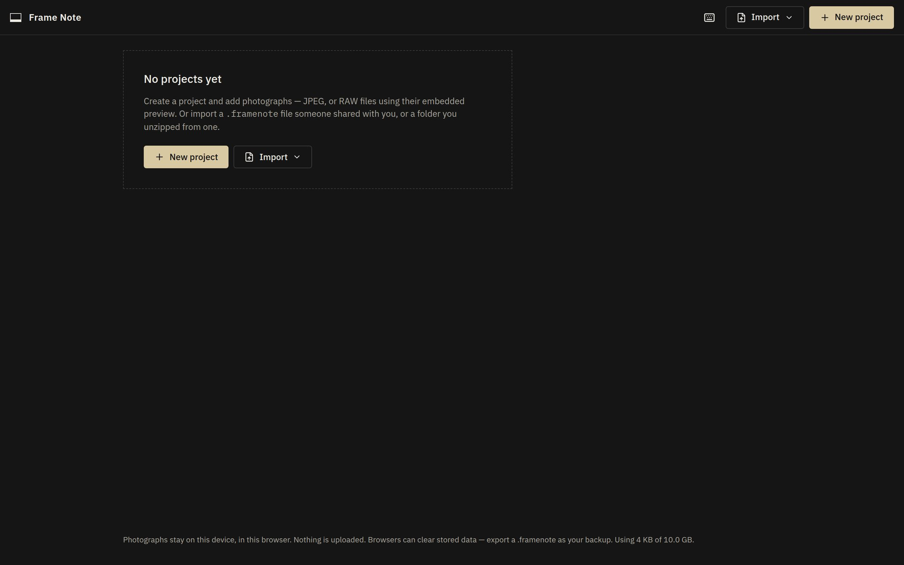

Click **New project**, give it a title and click **Create**.

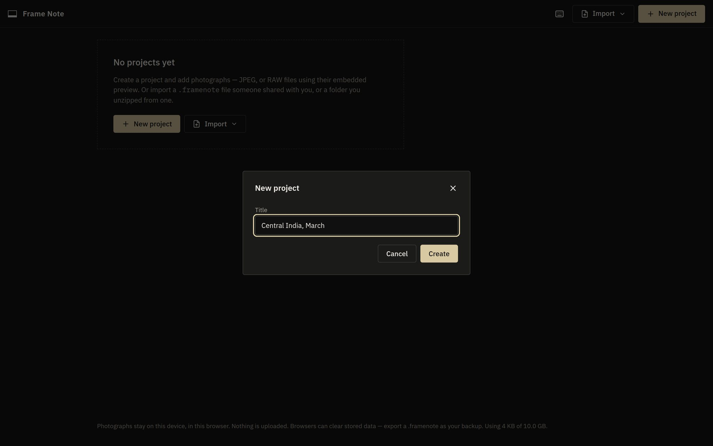

The project opens straight away, empty.

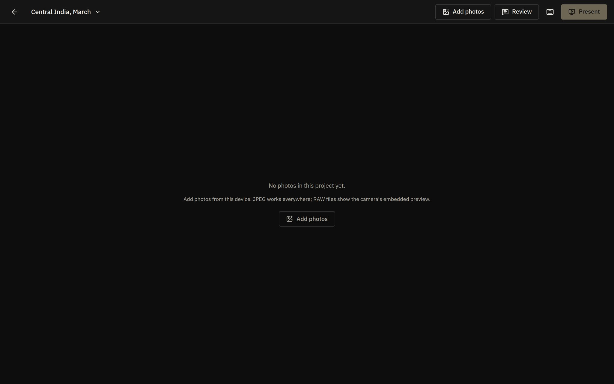

## 3. Add photographs

Click **Add photos** and pick your files, or drag them onto the window.

- **Desktop app:** RAW files (NEF, CR2, CR3, ARW), JPEG, TIFF and PNG. A **Folder** button next to **Add photos**
  adds every photograph in a folder at once. Camera data is read with ExifTool.
- **Browser:** JPEG and PNG everywhere. RAW files are shown from the preview the camera embeds in them. TIFF works in
  Safari only.

Your original files are never changed. Frame Note keeps its own copy, up to 4096 px on the long edge, inside the
project.

A progress bar shows how far the import has got. **Cancel** stops it, and keeps the photographs added so far.

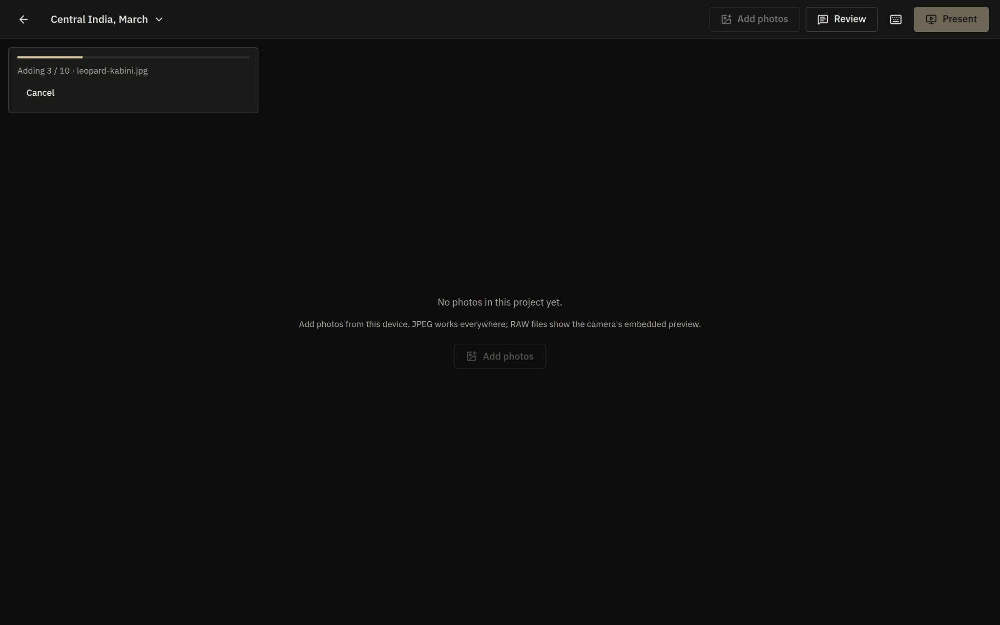

Files that can't be read are listed with the reason, and the rest are still added.

## 4. Look through your photographs

A project opens in **view mode**: the photograph, a thumbnail strip along the bottom and a small control bar.

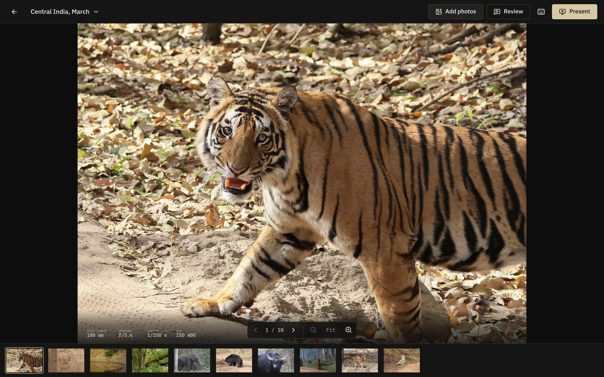

- **Next and previous:** `←` `→` (or `↑` `↓`), the arrows in the control bar, or click a thumbnail. On a trackpad or
  touch screen, swipe.
- **Zoom:** `+` and `−`, the magnifier buttons, `Ctrl` + scroll (`⌘` + scroll on a Mac), or pinch. Double-click
  zooms to 100% at that spot. Drag to move around. `0` or a click on the percentage goes back to fit.

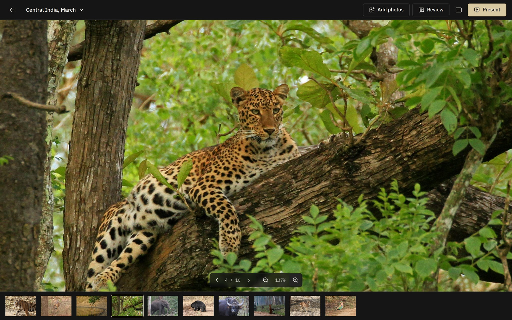

You can zoom to twice the stored image's actual pixels. Imported photographs are stored at up to 4096 px, so 100%
means 100% of that copy, not of the original RAW file.

- **Focus point:** press `A`, or the focus button at the end of the control bar, to show where the camera focused as
  small corner brackets. It is off until you turn it on, and the choice is remembered on this device for the editor,
  presentations and the folder viewer. Photos without recorded focus data show nothing (the button dims). The
  desktop app reads focus data from Nikon, Canon, Sony, Fujifilm, OM/Olympus and Panasonic files; the browser reads
  it from Nikon Z cameras and phones.

### Look through a folder without making a project

Frame Note can also stand in for Preview or Photos when you just want to look. Choose **Open → Photo…** (or
**Folder…**) on the projects screen, drop photos onto it, or in the desktop app right-click a photo in Finder or
Explorer and choose **Open With → Frame Note**. Every photo in that folder opens in order, whatever the format: RAW,
JPEG, HEIC, TIFF, PNG, WebP and more. RAW files show the camera's full-size embedded preview straight away.

The same keys work as in a project (`←` `→`, `Home` `End`, zoom, `A` for focus, `F` fullscreen), plus `O` for camera
data and `V` to stack it vertically. Nothing is copied or changed. Recent folders appear on the projects screen;
Frame Note remembers only where they are (the path on desktop, the folder permission in Chrome and Edge).

When a photo is worth keeping, use **Add to project** to copy it into an existing or new project, or **New project
from all N photos** to bring the whole folder in for captioning and presenting.

## 5. Review mode: captions, species and location

Click **Review** (or press `R`) when you want to work on the project rather than just look at it. Frame Note
remembers which mode you used last.

Review mode adds:

- **The filmstrip on the left.** Drag a photograph by its handle (⠿), or use the ▲ ▼ buttons, to change the order.
  The order is the order of the slideshow. The bin icon removes a photograph from the project; the original file is
  not touched.
- **Your notes on the right.** A **Caption**, the **Species** and the **Location** for each photograph. They appear
  on the photo during the presentation.
- **Project notes** at the bottom of the panel: the brief, or what you want reviewers to look at.
- **Show on photo**, **Export image** and **Export .framenote** in the top bar.

Everything saves by itself. "Saved locally" next to the title confirms it.

## 6. Comments and camera data

Below your notes is **Review comments**. Anyone looking at the project can leave one. **Your name** is optional,
and the app remembers it for next time. The count on the **Review** button shows how many comments the project has.

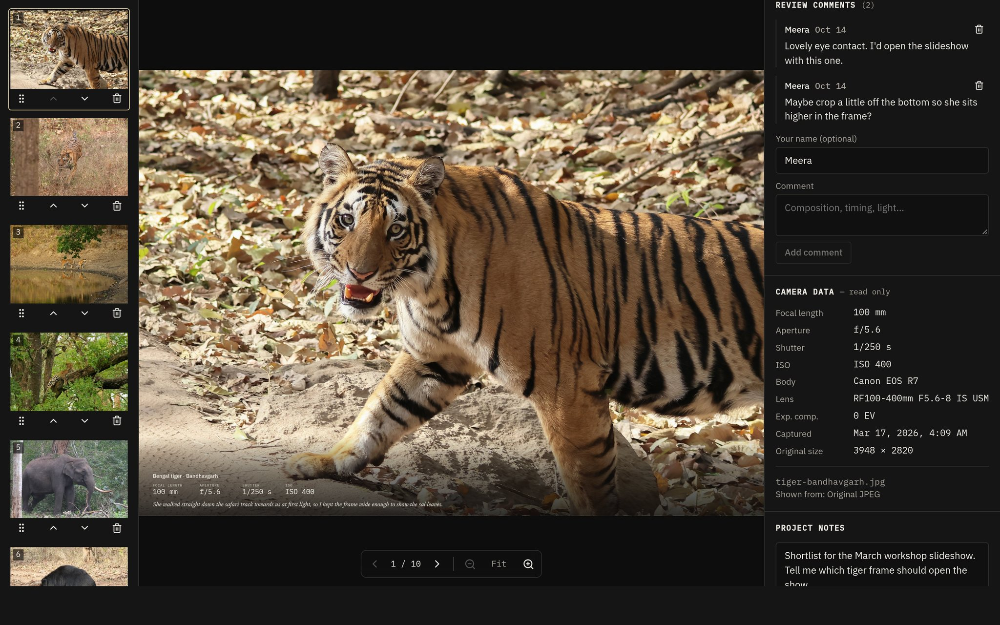

**Camera data** is read from the file and can't be edited: focal length, aperture, shutter speed, ISO, body, lens,
exposure compensation, capture time and original size. If a file has no camera data, the panel says so. Nothing is
filled in for you. Underneath is the original file name, and what the picture is shown from, for example "Original
JPEG" or the RAW file's embedded preview.

**Replace image…** under the file name swaps in a different file for this photo, for example a re-edited export.
The picture and its camera data come from the new file. The caption, species, location, comments and the photo's
place in the order stay as they are. Your original files are never changed.

## 7. Choose what shows on the photo

Click **Show on photo** (or press `I`) to choose what's drawn on the photograph.

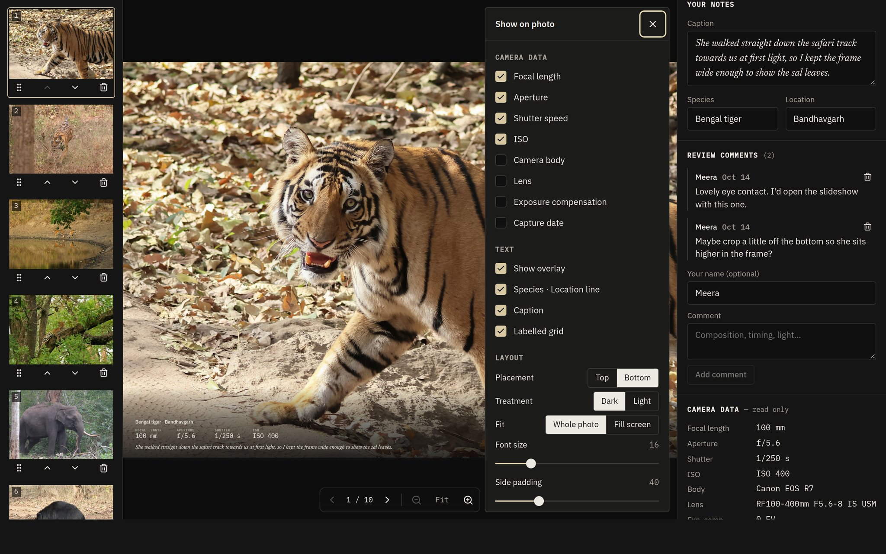

- **Camera data:** tick the fields to show, such as focal length, aperture, shutter speed, ISO, body, lens, exposure
  compensation and capture date.
- **Text:** turn the whole overlay on or off, the *Species · Location* line, the caption, and whether each value has
  a small label above it ("Labelled grid").
- **Layout:** camera data **horizontal** (side by side) or **vertical** (one field per line, which suits portrait
  photos), top or bottom, a dark or light treatment, the whole photo or fill the screen, font size, padding and
  background. Press `V` to switch between horizontal and vertical without opening the panel.

These settings belong to the project, so they apply to every photograph in it. They also travel with the project
when you share it.

## 8. Present

Click **Present** (or press `P`). The slideshow starts at the photograph you had selected.

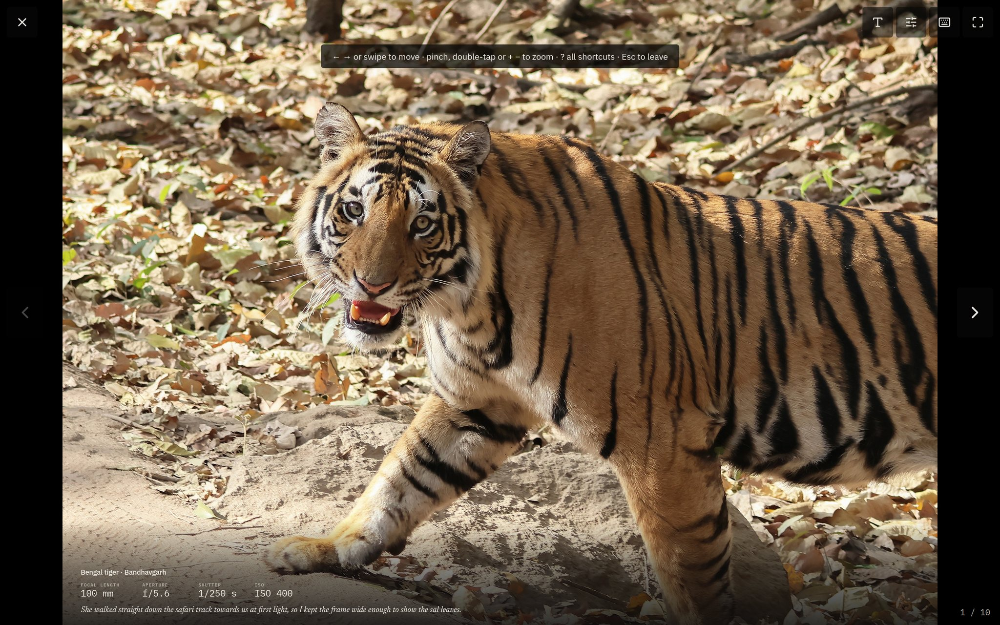

- **Next and previous:** `←` `→`, the arrows at the sides, or swipe. `Home` and `End` jump to the first and last
  photograph.
- **Overlay:** `O` turns it on and off. `V` switches the camera data between horizontal and vertical. `I` opens the
  same **Show on photo** panel as above.
- **Fullscreen:** `F`, or the button in the top-right corner. In fullscreen only the photograph and its overlay are
  shown: no buttons, counter or hints. Every key still works, and on a touch screen a tap brings the controls back.
- **Zoom:** works the same as in view mode.
- **Leave:** `Esc` first zooms back to fit, then leaves the presentation. You can also click the ✕ in the top-left
  corner.

Outside fullscreen, the controls fade away when you stop moving the mouse. Move it, or tap the screen, to bring them back.

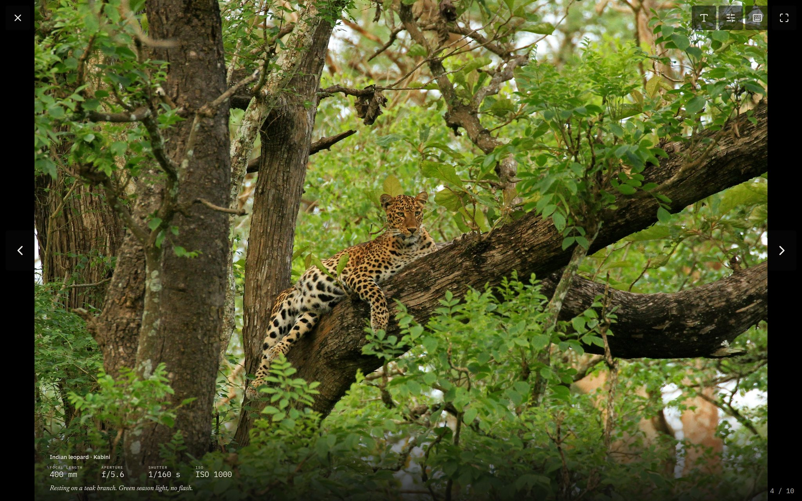

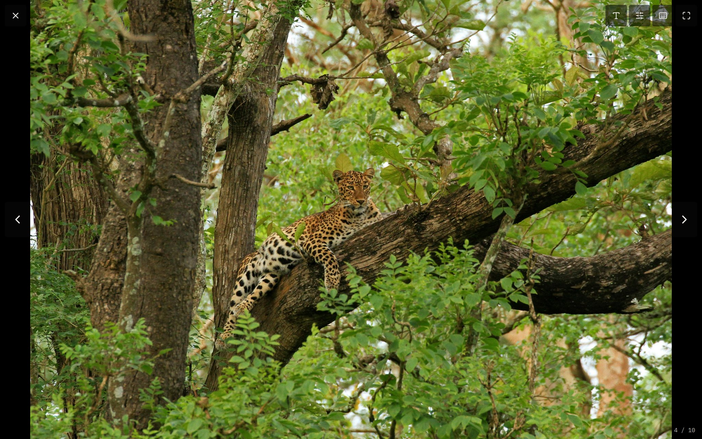

## 9. Export a single image

In review mode, click **Export image** to save the selected photograph as a JPEG or PNG.

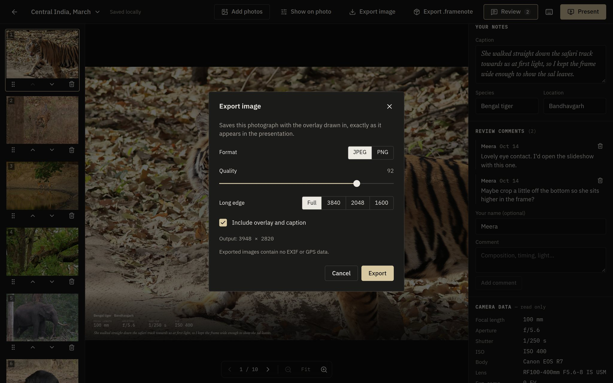

- **Format and quality:** JPEG with a quality slider, or PNG.
- **Long edge:** full size, 3840, 2048 or 1600 px.
- **Include overlay and caption:** draws the overlay into the image exactly as it looks in the presentation.

Exported images contain no EXIF or GPS data. The desktop app asks where to save the image. The browser puts it in
your downloads.

## 10. Share a whole project

Click **Export .framenote** to pack the whole project into one file: every photograph, caption, comment and
presentation setting. The file opens on any computer or phone browser, without the original RAW files.

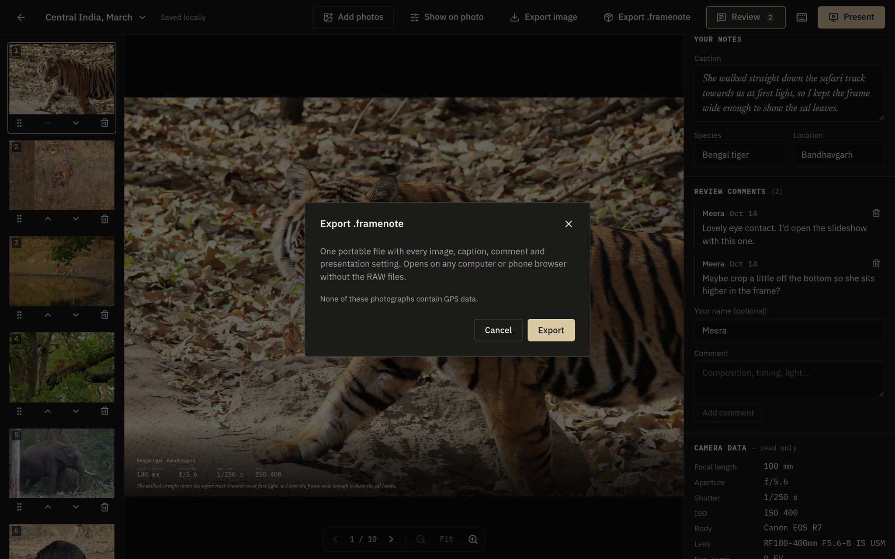

GPS locations from the camera are left out unless you tick **Include GPS locations from the camera**. That option
only appears when at least one photograph has a location.

Click **Export**. The desktop app asks where to save the file. The browser saves it to your downloads, and on a phone
it opens the share sheet.

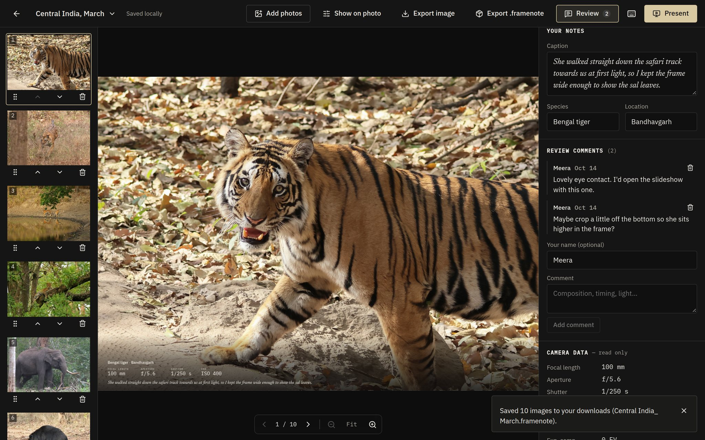

Send the file however you like: AirDrop, email, a USB stick or a shared drive.

## 11. Open a project someone sent you

On the projects list, click **Import** and choose **.framenote file**. You can also drag a `.framenote` file onto the
projects list.

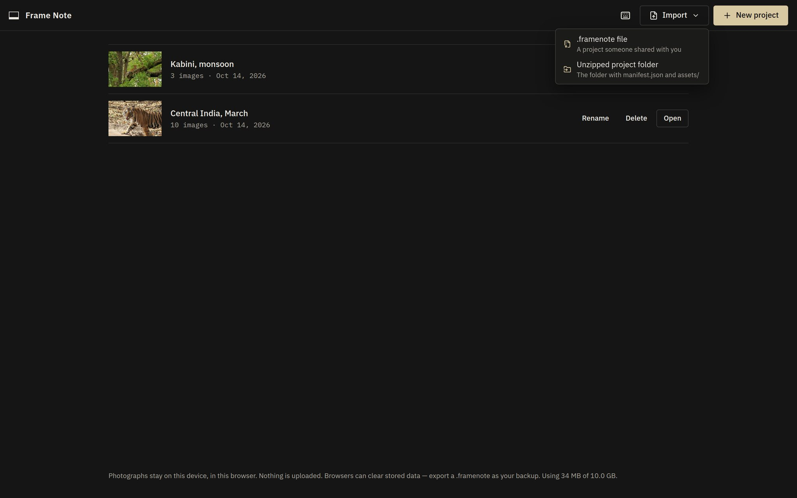

A `.framenote` file is a ZIP archive. If someone has unzipped it, choose **Unzipped project folder** and pick the
folder that contains `manifest.json`. This works in the desktop app, desktop browsers and Android, but not on an
iPhone or iPad.

The project opens with all its photographs, notes and comments:

Importing never overwrites anything. If you already have the same project, you get a copy with "(imported)" added to
its title. To pass a reviewed project back, the reviewer adds comments and exports a new `.framenote`.

## 12. Switch, rename and delete projects

Click the project title at the top left to switch to another project, rename this one, or go back to the full list.

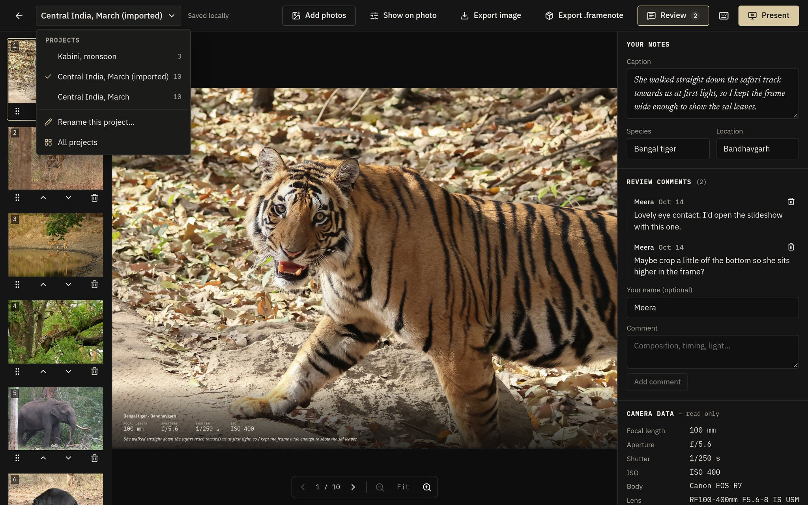

The ← button, or **All projects**, opens the projects list. Each row has **Rename**, **Delete** and **Open**.

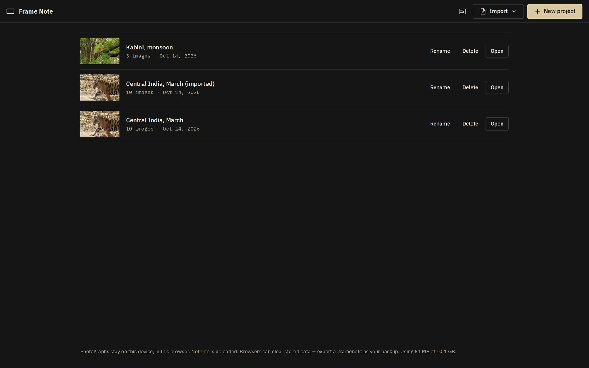

**Delete** removes the project and Frame Note's copies of its photographs. Your original files are not touched. It
can't be undone, so export a `.framenote` first if you might want the project back.

## 13. Keyboard shortcuts

Press `?`, or click the keyboard button in the top bar, to see every shortcut. On a Mac, `Ctrl` reads as `⌘`.

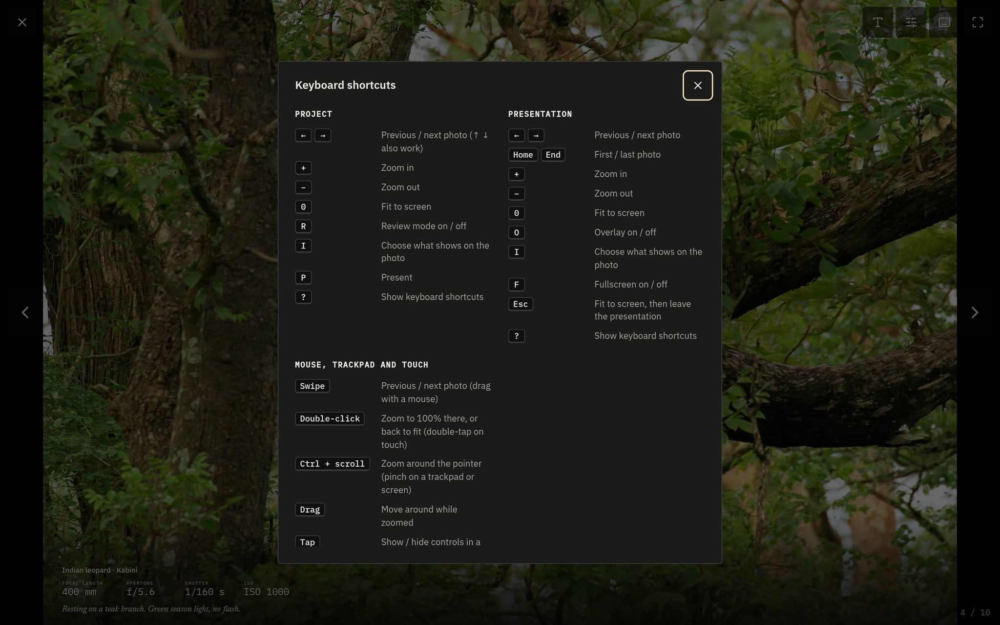

| Key | In a project | In a presentation |
|---|---|---|
| `←` `→` | Previous / next photograph (`↑` `↓` too) | Previous / next photograph |
| `Home` `End` | | First / last photograph |
| `+` `−` `0` | Zoom in / out / fit | Zoom in / out / fit |
| `A` | Focus point on / off | Focus point on / off |
| `R` | Review mode on / off | |
| `I` | Show on photo | Show on photo |
| `V` | Camera data horizontal / vertical | Camera data horizontal / vertical |
| `P` | Present | |
| `O` | | Overlay on / off |
| `F` | | Fullscreen on / off |
| `Esc` | | Fit to screen, then leave |
| `?` | Keyboard shortcuts | Keyboard shortcuts |

The folder viewer uses the presentation keys, with `A` for focus, `O` for camera data and `V` to stack it.

## 14. Where your photographs are kept

Nothing leaves your device. There are no accounts, uploads or analytics.

- **Desktop app:** in the app's data folder on your computer.
- **Folder viewer:** photos stay where they are. Frame Note remembers only recent folder locations.
- **Browser:** in that browser's storage on that device. The projects list shows how much space is in use.
  Browsers can clear stored data, so treat an exported `.framenote` as your backup.

To move a project between your phone and your computer, export a `.framenote` on one and import it on the other.
Projects don't sync by themselves yet. See [SYNC.md](SYNC.md).

## Photo credits

The photographs in this guide come from Wikimedia Commons and are shown, resized, inside the app's screens.

| Photograph | Photographer | Licence |
|---|---|---|
| [Bengal tiger, Bandhavgarh](https://commons.wikimedia.org/wiki/File:Bengal_tiger_in_Bandhavgarh_National_Park_02.jpg) | Bernard Gagnon | [CC BY 4.0](https://creativecommons.org/licenses/by/4.0) |
| [Bengal tiger, Kanha](https://commons.wikimedia.org/wiki/File:Bengal_tiger_in_Kanha_National_Park_01.jpg) | Bernard Gagnon | [CC BY 4.0](https://creativecommons.org/licenses/by/4.0) |
| [Tigers at a waterhole, Kanha](https://commons.wikimedia.org/wiki/File:Tiger_in_kanha_np.jpg) | Davidvraju | [CC0](https://creativecommons.org/publicdomain/zero/1.0/) |
| [Indian leopard, Kabini](https://commons.wikimedia.org/wiki/File:Leopard_-_Kabini-David_Raju.jpg) | Davidvraju | [CC0](https://creativecommons.org/publicdomain/zero/1.0/) |
| [Asian elephant, Nagarhole](https://commons.wikimedia.org/wiki/File:Asian_Elephant_Elephas_maximus_Single_Tusk_Nagarahole_Tiger_Reserve_DSCN6868_01.jpg) | Rohitjahnavi | [CC BY 4.0](https://creativecommons.org/licenses/by/4.0) |
| [Sloth bear, Satpura](https://commons.wikimedia.org/wiki/File:Sloth_bear_in_Satpura_National_Park_01.jpg) | Bernard Gagnon | [CC BY 4.0](https://creativecommons.org/licenses/by/4.0) |
| [Gaur, Satpura](https://commons.wikimedia.org/wiki/File:Gaur_in_Satpura_National_Park_03.jpg) | Bernard Gagnon | [CC BY 4.0](https://creativecommons.org/licenses/by/4.0) |
| [Dhole, Kabini](https://commons.wikimedia.org/wiki/File:Dhole_from_Kabini.jpg) | Yajuvendraupadhyaya | [CC BY 4.0](https://creativecommons.org/licenses/by/4.0) |
| [Chital, Bandhavgarh](https://commons.wikimedia.org/wiki/File:Spotted_deer_in_Bandhavgarh_National_Park_08.jpg) | Bernard Gagnon | [CC BY 4.0](https://creativecommons.org/licenses/by/4.0) |
| [Indian roller, Bandhavgarh](https://commons.wikimedia.org/wiki/File:Indian_roller_in_Bandhavgarh_National_Park_02.jpg) | Bernard Gagnon | [CC BY 4.0](https://creativecommons.org/licenses/by/4.0) |

The captions, species, locations and comments in the screenshots were written for this guide.
